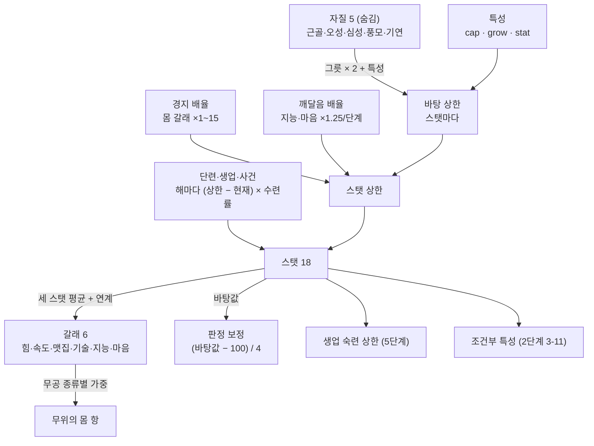
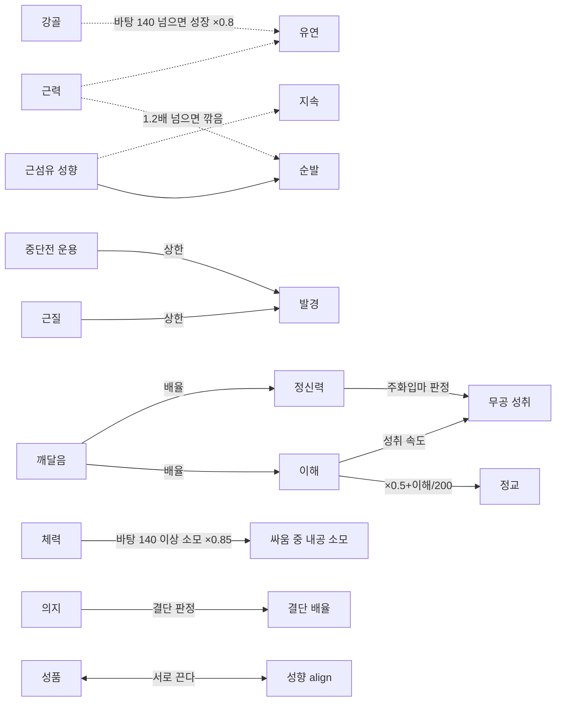

# 스탯 정리

인물의 수치가 어떤 층으로 쌓이는지, 서로 무엇을 주고받는지, 어느 단계에서 어디에 쓰이는지를 한곳에 모았다. 정의의 정본은 1단계(`docs/p1-combat.md`)이고 이 문서는 그것을 묶어 보이는 지도다. 2026-11-24에 정한 두 가지를 반영했다.

- **자질은 남기되 숨긴다.** 출생 때 굴리는 자질 다섯은 엔진 안에서만 쓰고 화면에는 숫자 대신 특성처럼 보이는 표지로만 드러난다(2장).
- **심성을 스탯으로 나눈다.** 주화입마·심마·결단 판정에 쓰던 자질 심성은 새 갈래 「마음」의 세 스탯(정신력·의지·성품)이 맡는다(4장).

판정은 엔진 안에서 `d100 + 보정 ≥ DC`로 굴리고 화면에는 주사위 눈과 DC를 보이지 않는다. 결과(대성공·성공·실패·대실패)만 보이고 확률을 어느 정도 보여 주는 기능은 나중에 따로 붙인다.

## 1. 층 구조

| 층 | 무엇 | 범위 | 바뀌는가 |
|---|---|---|---|
| 0. 자질 | 근골·오성·심성·풍모·기연 | 15~90(`3d6 × 5`), 특성으로 100 넘음 | 거의 안 바뀜. 영약·환골탈태·특성으로만 |
| 1. 바탕 상한 | 스탯마다 사람 몸·머리가 닿는 한계 | `그릇 자질 × 2 + 특성 가산` (평균 104) | 자질과 특성을 따라 |
| 2. 스탯 상한 | 지금 오를 수 있는 끝 | 바탕 상한 × 경지 배율(몸) 또는 × 깨달음 배율(지능·마음) | 경지·깨달음이 오를 때 크게 |
| 3. 스탯 | 실제 값 | 0 ~ 상한 (현경 근력은 천 단위) | 해마다 단련으로 |
| 4. 바탕값 | `스탯 ÷ 배율` | 0~180 안팎 | 스탯을 따라 |
| 5. 갈래 값 | 세 스탯 평균 + 연계 보정 | 스탯과 같은 척도 | 스탯을 따라 |
| 6. 쓰는 곳 | 무위 몸 항, 판정, 생업, 특성 조건 | 각 단계 | - |

바탕값은 경지를 뺀 "그 사람이 자기 몸과 머리를 얼마나 갈고닦았는가"다. 판정·생업·특성 조건은 모두 바탕값으로 따지므로 경지가 높다고 글을 더 잘 읽게 되지는 않는다.

## 2. 자질 (숨김)

| 자질 | 그릇이 되는 스탯 | 그 밖에 쓰이는 곳 |
|---|---|---|
| 근골 | 힘·속도·맷집 갈래 전부, 반응·유연은 오성과 반반 | 입문 시험(4단계) |
| 오성 | 기술 갈래(정교·수읽기), 지능 갈래 전부 | 무공 성취 상한 +1~2(75·90 이상), 돌파 보정, 입문 시험 |
| 심성 | 마음 갈래 전부(4장) | - (판정은 이제 마음 스탯이 맡는다) |
| 풍모 | 스탯 없음 | 첫인상·인연 생성(6단계), 기예 생업 |
| 기연 | 스탯 없음 | 기연 사건 확률(7단계)만. 화면에 절대 보이지 않는다 |

**화면 표지.** 자질 숫자는 보이지 않는다. 대신 양 끝에 들면 특성 목록에 표지가 붙는다. 가운데(40~64, 약 58%)는 아무것도 붙지 않는다. 기연은 표지가 없고 운은 행운아·불운 같은 운 특성(2단계 3-6)으로만 보인다.

| 자질 값 | 비율 | 근골 | 오성 | 심성 | 풍모 |
|---|---|---|---|---|---|
| 75 이상 | 9.3% | 타고난 근골 | 깨우침이 빠름 | 마음이 굳음 | 빼어난 풍모 |
| 65~74 | 16.7% | 근골이 좋음 | 이해가 빠른 편 | 심지가 있음 | 호감 가는 얼굴 |
| 30~39 | 11.6% | 근골이 약함 | 이해가 더딘 편 | 마음이 여림 | 볼품없음 |
| 29 이하 | 4.6% | 허약한 골격 | 깨우침이 더딤 | 마음이 쉽게 흔들림 | 험상궂음 |

비율은 `3d6 × 5`의 분포에서 나온 값이다. 이 표지가 생기면 2단계 소소한 특성 「근골이 조금 좋음 ↔ 근골이 조금 약함」(`stat{근골:±5}`)은 표지와 겹치므로 뺀다. 무골·병약·천재·멍청함 같은 큰 특성은 자질을 옮기는 효과로 그대로 두고 옮긴 뒤의 자질로 표지를 다시 정한다.

## 3. 스탯 18

| 갈래 | 스탯 | 뜻 | 그릇 | 배율 | 주로 오르는 일 |
|---|---|---|---|---|---|
| 힘 | 근력 | 최대로 내는 힘 | 근골 | 경지 | 짐 나르기, 농사, 대장일, 외공 |
| | 근질 | 근육의 밀도(실전 근육) | 근골 | 경지 | 실전, 외공 |
| | 발경 | 힘을 한순간에 터뜨림 | 근골 | 경지 | 운기조식(중단전과 함께) |
| 속도 | 순발 | 단거리 가속, 선공 | 근골 | 경지 | 경공, 사냥 |
| | 지속 | 오래 달리고 싸움 | 근골 | 경지 | 경공, 표행 |
| | 반응 | 반사신경, 피하기 | 근골·오성 | 경지 | 실전, 곡예 |
| 맷집 | 체력 | 숨과 지구력 | 근골 | 경지 | 짐 나르기, 농사 |
| | 강골 | 뼈·근막·피부의 단단함 | 근골 | 경지 | 외공 |
| | 회복 | 상처·내상이 낫는 속도 | 근골 | 경지 | 운기조식 |
| 기술 | 정교 | 초식을 정확히 펼침 | 오성 | 경지 | 초식 수련 |
| | 유연 | 관절 가동, 변초 | 근골·오성 | 경지 | 초식 수련, 곡예 |
| | 수읽기 | 상대의 수·기척 읽기 | 오성 | 경지 | 실전, 사냥 |
| 지능 | 이해 | 무공을 이해하는 힘 | 오성 | 깨달음 | 경전·글공부 |
| | 지략 | 계략, 진법, 전술 | 오성 | 깨달음 | 병법·장기·바둑 |
| | 학식 | 글, 의술, 비급 해독 | 오성 | 깨달음 | 경전·글공부 |
| 마음 | 정신력 | 흔들리지 않고 버티는 힘 | 심성 | 깨달음 | 운기조식, 참선, 폐관 |
| | 의지 | 끝까지 밀어붙이는 힘 | 심성 | 깨달음 | 고된 수련, 생사결을 넘김, 굶주림을 견딤 |
| | 성품 | 사람됨, 수양 | 심성 | 깨달음 | 협행·선행, 스승의 가르침, 경전 |

회복의 그릇은 예전에 근골·심성이었는데 심성이 마음 갈래로 옮겨 가므로 근골만 남긴다. 마음 갈래는 나이로 떨어지지 않는다. 성품은 무고한 살생·배신·약탈 한 번마다 바탕값 −5~−15로 깎인다(살생 계수기와 함께, 2단계 3-12).

## 4. 마음 갈래: 심성 판정을 나눠 맡는다

예전 문서에서 "심성 판정"이던 것을 셋으로 나눈다. 판정 보정은 다른 스탯과 같이 `(바탕값 − 100) / 4`다. 바탕값 100이 보정 0, 180이 +20으로, 예전 `(심성 − 50) / 2`와 같은 폭이다.

| 스탯 | 맡는 판정 | 예전 문서 자리 |
|---|---|---|
| 정신력 | 내공 넘침(기혈역류), 주화입마(정·사 겸수, 돌파 대실패), 마공의 해마다 심마 판정, 탈혼 저항, 공포증, 임독양맥 타통 | 1단계 4-4, 2단계 1-4, 3단계 2·5·6·8, 2단계 3-12 공포증 |
| 의지 | 결단(사생결단 DC 50, 동귀어진 DC 70), 고문·유혹 견디기, 중독(노름·주독) 벗어나기 | 1단계 6-1, 2단계 3-12 노름 중독 |
| 성품 | 살기·심마·마두화로 빠지지 않기, 교만, 문파 입문 면담, 스승이 제자로 받는 판정 | 2단계 3-12 살기·심마·마두화·교만, 4단계 입문 |

세 스탯이 따로 노는 인물이 생긴다. 의지는 강한데 성품이 낮은 사람은 끝까지 버티는 악인이 되고 성품은 높은데 정신력이 약한 사람은 착하지만 마공 하나에 무너진다. 마음 갈래는 무위의 몸 항에 들어가지 않는다. 싸움에는 결단과 주화입마를 거쳐서만 닿는다.

## 5. 서로 주고받는 것

실선은 올려 주는 것, 점선은 깎거나 한쪽을 키우면 다른 쪽이 줄어드는 것이다.

| 관계 | 규칙 | 정본 |
|---|---|---|
| 부피 근육 | 근력이 근질의 1.2배를 넘으면 넘는 만큼의 절반을 순발·유연에서 뺀다 | 1단계 2-4 |
| 근섬유 성향 | −30~+30. 순발 상한 ×(1 + 성향/100), 지속 상한 ×(1 − 성향/100) | 1단계 2-4 |
| 단단함과 부드러움 | 강골 바탕값 140 초과면 유연 성장 ×0.8(연골 특성이면 없음) | 1단계 2-4 |
| 이해와 수련 | 정교 성장과 무공 성취 속도 × `0.5 + 이해/200`(2.0 상한) | 1단계 2-4 |
| 발경 | 상한 `min(근질, 운용 × 2 × 경지 배율)` | 1단계 2-4 |
| 체력과 내공 | 체력 바탕값 140 이상이면 싸움 중 내공 소모 ×0.85 | 1단계 2-4 |
| 정신력과 내공 | 정신력은 넘침·주화입마 판정을 맡아 영약과 마공을 얼마나 안전하게 쓰는지를 정한다 | 4장 |
| 의지와 결단 | 결단 판정을 맡는다. 결단 배율 자체는 1단계 6-1 표 그대로 | 4장 |
| 성품과 성향 | 성품이 높으면 정(正) 쪽 행동에서 성향이 더 빨리 오르고, 성향이 사·마 쪽이면 성품 성장 ×0.5 | 새로 정함(6단계에서 맞춤) |
| 깨달음과 지능·마음 | 깨달음 1마다 지능·마음 갈래 상한 ×1.25 | 1단계 2-2 |
| 경지와 몸 | 경지 배율 범인 1 ~ 현경 15가 몸 갈래 상한에 곱해진다 | 1단계 2-2 |
| 나이 | 15세까지 상한의 60%, 55세부터 근력·순발·지속·체력 해마다 −2% | 1단계 2-2 |

## 6. 다른 축과의 관계

스탯과 나란히 따로 쌓이는 축이 넷 있다. 스탯과 섞이지 않고 무위 공식에서 따로 곱한다.

| 축 | 범위 | 스탯과 닿는 곳 | 정본 |
|---|---|---|---|
| 내공(하단전 축기·용량, 정순도, 음양오행) | 년 단위 | 체력(소모), 정신력(넘침), 회복(운기조식) | 1단계 4장 |
| 운용(중단전) | 0~100 | 발경 상한 | 1단계 4-2 |
| 실전 | 0~1000 | 근질·반응·수읽기가 같은 일(실전)로 함께 오른다 | 1단계 3장 |
| 깨달음 | 0~5 | 지능·마음 상한 배율, 무공 성취 상한 | 2단계 1-3 |
| 무학 | 주무공 등급 × 성취 | 이해가 성취 속도를 정한다 | 1단계 5-2, 3단계 9장 |

## 7. 어디에 쓰이나

| 쓰는 곳 | 쓰는 값 | 단계 |
|---|---|---|
| 무위의 몸 항 | 갈래 값 다섯(힘·속도·맷집·기술·지능)을 주무공 종류별 가중치로. `몸 = 갈래 / (100 × 경지 배율)` 비로 따지고 0.7~1.4로 자른다 | 1단계 2-5, 5-3 |
| 판정 보정 | 판정에 맞는 스탯 하나의 바탕값, `(바탕값 − 100) / 4` | 1단계 6-1 |
| 도주 | 순발 실제 값(경지 배율 포함) 비교 | 1단계 6-4 |
| 무공 성취 속도 | 이해 | 3단계 3-3 |
| 비급 해독 | 학식·이해 바탕값 | 3단계 7장 |
| 조건부 특성 | 스탯 바탕값 구간(비실, 허약, 문맹 등) | 2단계 3-11 |
| 문파의 결 | 결에 맞는 스탯 두 개의 바탕값 평균(130 이상 ×1.2, 80 이하 ×0.85) | 3단계 9-3 |
| 입문 시험 | 근골·오성(자질), 면담은 성품 | 4단계 4장 |
| 생업 숙련 상한 | 생업마다 주 스탯·부 스탯의 바탕값(아래) | 5단계 |

**생업은 스탯 수치로 돌린다.** 5단계 초안은 숙련 상한을 자질(`주 자질 × 8 + 부 자질 × 4`)로 정했는데, 스탯 바탕값으로 바꿨다(5단계 2-1). `숙련 상한 = 주 스탯 바탕값 × 4 + 부 스탯 바탕값 × 2`(최대 1000). 바탕값이 자질의 두 배 척도라서 보통 사람의 상한은 예전과 같은 600 안팎이다. 다른 점은 생업을 하면서 그 스탯이 함께 자라고 무공 수련으로 키운 몸도 생업에 쓰인다는 것이다. 대장장이는 근력·정교, 상인은 지략·학식, 의원은 학식·정교, 도둑은 반응·정교, 어부는 체력·지속처럼 정한다. 기연·풍모 같은 숨은 자질은 생업 숙련에 쓰지 않는다.

## 8. 반영한 곳

이 문서의 결정을 2026-11-24에 아래 파일에 옮겼다(1단계·2단계 개정 4). 개정 전 파일은 `sources/backup/rev3/`에 있다. `tools/p2_sim.js`는 심성을 쓰지 않아 경지 분포가 그대로다. `data/items.js`의 공청석유·미혼약과 `data/events.js`의 은거기인 시험도 함께 고쳤다.

| 파일 | 고친 것 |
|---|---|
| `docs/p1-combat.md` | 2-1 표에 마음 갈래 추가, 회복 그릇, 6-1의 화면 표시 문장(주사위를 보이지 않음), 심성 판정 → 정신력·의지 |
| `docs/p2-traits-realms.md` | 3장의 `stat{심성}`·심성 판정을 마음 스탯으로, 「근골이 조금 좋음 ↔ 조금 약함」 삭제, 자질 표지 표 추가 |
| `docs/p3-arts.md` | 마공·겸수·탈혼·공청석유의 심성 판정 → 정신력 |
| `docs/p4-factions.md` | 입문 면담 → 성품 |
| `docs/p5-careers.md` | 숙련 상한을 스탯 바탕값으로, 생업별 주·부 스탯, 검산 다시 |
| `tools/gen_traits.js`, `data/traits.js` | 새 스탯 이름 인식, 재생성 |
| `tools/p5_sim.js` | 생업 숙련 상한을 스탯 바탕값으로, 생업 16개 전부 검산 |
| `HANDOFF.md` 1장 | "주사위 판정을 화면에 드러낸다" → 뒤에서 굴리고 결과만 보인다 |

## 9. 확인하지 못한 것

- 마음 갈래의 성장 속도와 성품이 깎이는 폭은 설계값이다. 시뮬레이션으로 아직 돌리지 않았다.
- 자질 표지의 이름과 구간은 새로 지었다. 2단계의 큰 특성(무골·천재 등)과 이름이 비슷해 보일 수 있어 화면에서 함께 볼 때 헷갈리지 않는지 확인이 필요하다.
- 성품과 성향(align)의 관계는 6단계 명성·악명 설계에서 다시 맞춘다.
